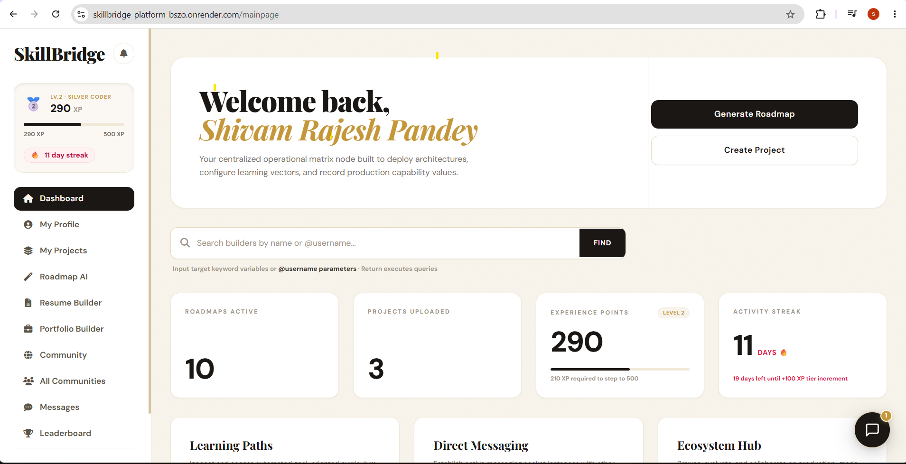
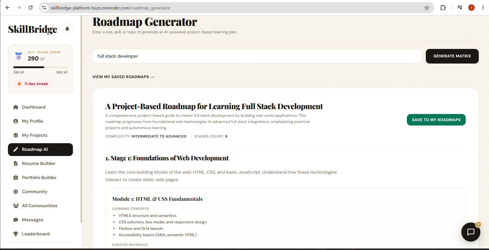
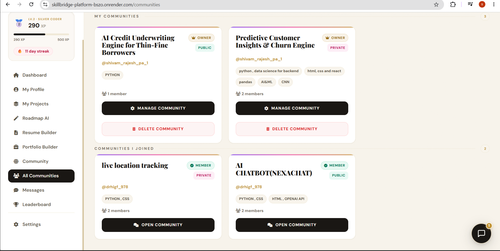
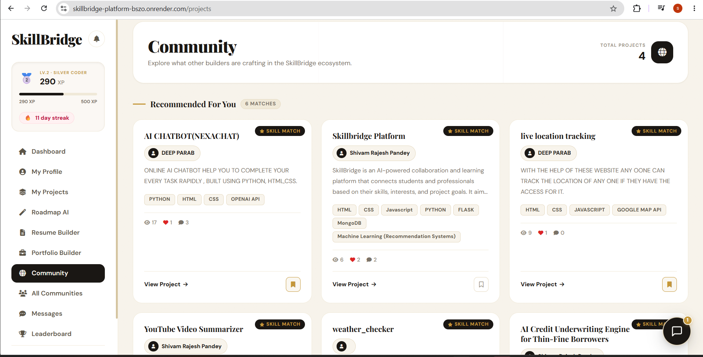
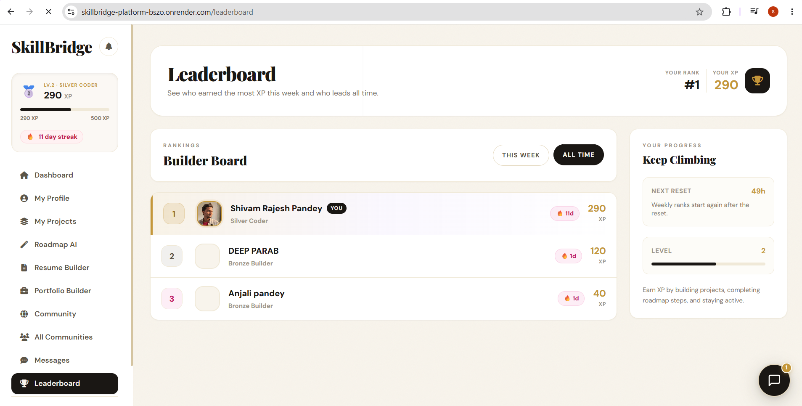
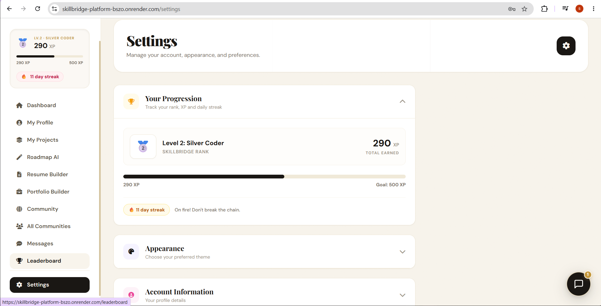
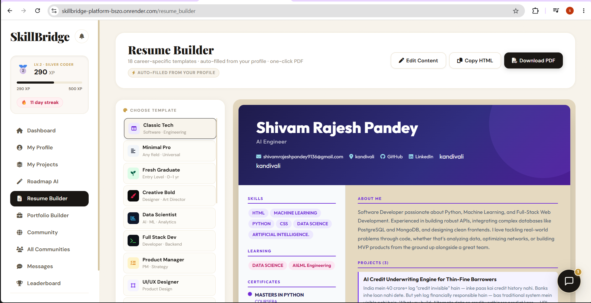
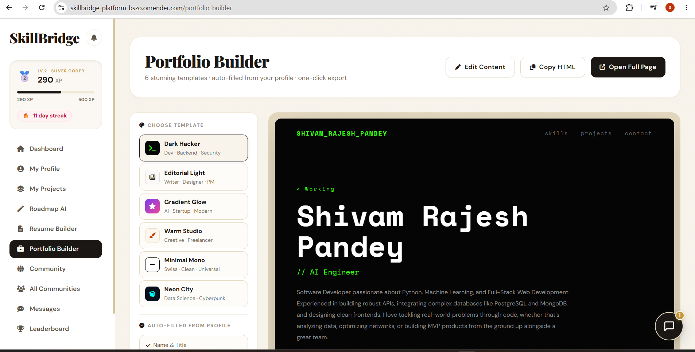
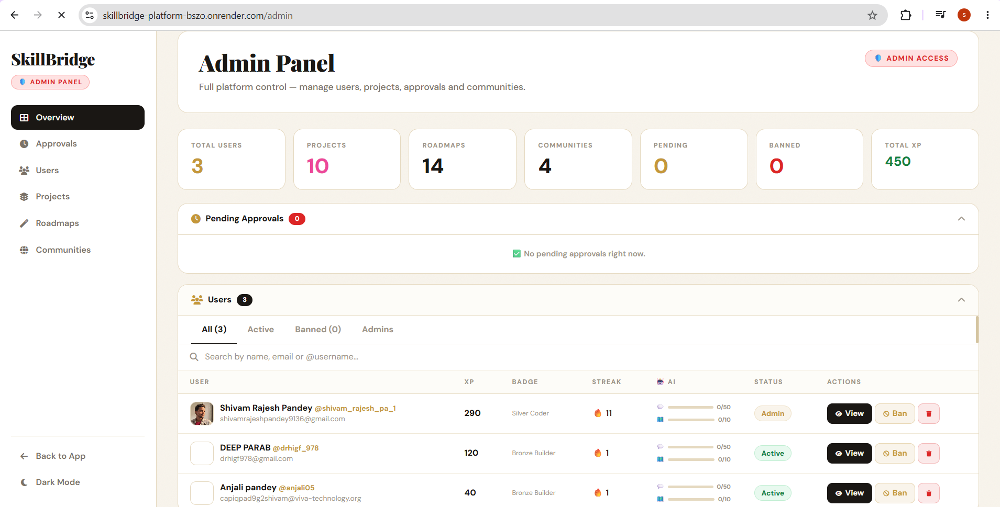

# 🚀 SkillBridge-Platform

### AI-Powered Career OS for Developers


SkillBridge is a comprehensive platform designed to bridge the gap between learning and professional success. It leverages AI to provide personalized guidance, project-based learning, and professional identity building.

---

## 🎯 Why SkillBridge?

Most developers — especially students and self-taught learners — know what to learn but have no structured path to get there. They spend hours jumping between tutorials, building generic CRUD projects, and ending up with a resume that looks identical to everyone else's. SkillBridge fixes this. It takes your current skills and career goal, generates a personalized, stage-by-stage roadmap with real-world projects, and automatically builds your portfolio and resume as you progress — so by the time you're job-ready, you already have proof.

---

## 🌐 Live Demo

🔗 https://skillbridge-platform-bszo.onrender.com/

---

## 🏠 Platform Preview/Dashboard



---

## ✨ Key Features

- 🤖 AI-Powered Roadmap Generator
- 📄 ATS-Friendly Resume Builder
- 🌐 Portfolio Generator
- 🤝 Community & Collaboration Hub
- 🎯 AI Project Recommendation Engine
- 🏆 XP, Streaks & Leaderboards
- ⚙️ Personalized Dashboard
- 🛡️ Admin Management System

---

## ⚙️ How It Works

1. Enter your skills, interests, or career goal
2. AI generates a personalized roadmap
3. Get real-world project recommendations
4. Build your portfolio and resume automatically

---

## 🤖 AI Roadmap Generator

Generate structured, project-based learning paths using AI.
The system breaks down your goal into stages with real-world tasks.



---

## 🤝 Community & Smart Recommendations

Discover projects and collaborators based on your skills and interests using intelligent matching.




---

## 📊 Personalized Dashboard

Track your progress, XP, streaks, and activity in one place.



---

## ⚙️ Settings & Progress Tracking

Monitor your XP, streaks, rank progression, and personalize your SkillBridge experience through an integrated settings system.



---

## 📄 Resume Builder

Create ATS-friendly resumes automatically using your profile and project data.



---

## 🌐 Portfolio Builder

Generate stunning developer portfolios with customizable templates.



---

## 🛡️ Admin Control Center

A powerful administration dashboard enables platform-wide management, including user moderation, project oversight, roadmap tracking, community management, approvals, XP control, and detailed user profile inspection.



---

## 🛠️ Tech Stack

| Layer | Technology |
|---|---|
| **Backend** | Python (Flask) |
| **Database** | MongoDB |
| **AI Engine** | Mistral AI |
| **Frontend** | HTML, CSS, JavaScript |
| **Authentication** | Flask-Login, Flask-Bcrypt |
| **Deployment** | Render |

---

## 📂 Project Structure

```
SkillBridge-Platform/
├── app.py                        # Main Flask application
├── ai_roadmap_generator.py       # Mistral AI roadmap logic
├── recommendation_engine.py      # Skill-based recommendation engine
├── gunicorn.conf.py              # Gunicorn server configuration
├── wsgi.py                       # WSGI entry point
├── Procfile                      # Render deployment config
├── requirements.txt              # Python dependencies
├── templates/
│   ├── mainpage.html             # Dashboard
│   ├── community_chat.html       # Real-time community chat
│   ├── resume_builder.html       # ATS resume builder
│   ├── portfolio_builder.html    # Portfolio generator
│   ├── admin.html                # Admin control panel
│   ├── view_roadmap.html         # Roadmap viewer
│   ├── find_communities.html     # Community discovery
│   └── ...                      # 20+ more templates
├── static/
│   ├── css/
│   └── js/
└── .gitignore
```

---

## ⚙️ Installation & Setup

1. **Clone the repository**

```bash
git clone https://github.com/Shivam7977/SkillBridge-Platform.git
cd SkillBridge-Platform
```

2. **Install dependencies**

```bash
pip install -r requirements.txt
```

3. **Create a `.env` file** and add your keys:

```env
MISTRAL_API_KEY=your_mistral_api_key
MONGO_URI=your_mongodb_connection_string
RESEND_API_KEY=your_resend_api_key
SECRET_KEY=your_flask_secret_key
YOUTUBE_API_KEY=your_youtube_api_key
```

4. **Run the app**

```bash
python app.py
```

---

## 🤝 Contributing

Pull requests are welcome! For major changes, please open an issue first to discuss what you'd like to change.

1. Fork the repository
2. Create your feature branch

```bash
git checkout -b feature/your-feature-name
```

3. Commit your changes

```bash
git commit -m 'Add your feature description'
```

4. Push to the branch

```bash
git push origin feature/your-feature-name
```

5. Open a Pull Request

---

## 👨‍💻 Developer

Developed with ❤️ by **Shivam Pandey**

[](https://www.linkedin.com/in/shivam-pandey-0336ba336/)
[](https://shivam-ai-portfolio.netlify.app/)
[](https://github.com/Shivam7977)

""" # Brutally honest GitHub review: Shivam7977

Reviewed on October 11, 2026 · Public profile and repository-level inspection

[GitHub Vs. Bitbucket: Which Code Hosting Platform is Best? - Hatica](https://images.openai.com/static-rsc-4/h6nY0yf7JsEycY0Sx4mRb8nNKCcIcOBcXiDBB5zoyQB53kJfJ3b9fumZfym32-9QtI9bMIOfte8A4pxGn5j31kvTkB5L6rFXiUBQgJque7-Zjv7CR_c2oXmVt6Bh1m44flmqva6djfbFywIxlr_rYABjp8Znp5gQnvWf0wXwtYs?purpose=inline)

# Shivam Rajesh Pandey

Final-year CSE (AI/ML) student · Flask · ML · Data Science

[Open GitHub profile](https://github.com/Shivam7977)

I'm not going to rate this account based on a fancy README, GitHub contribution squares, or the number of projects alone. I've inspected the public profile, repository layouts, visible project documentation, commit-history counts, and parts of the actual `SkillBridge-Platform/app.py` source. I also checked the structure and claims of the fraud-detection and PDF RAG projects.&#x20;

[image](https://www.google.com/s2/favicons?domain=https://github.com\&sz=32)

GitHub

+4


One limitation: I could not reliably inspect every source file in all seven repositories, execute the applications, or independently reproduce the reported model metrics. I'll distinguish visible problems from things that still need verification.

MY OVERALL RATING

# 6.0/10

for a student / entry-level AI-ML profile

The verdict: Ambitious project selection, decent breadth, and evidence of building substantial applications. But the public evidence of engineering depth, testing discipline, and reliable ML evaluation doesn't yet match the ambition of the project descriptions.

Project ambition

## 8/10

Visible architecture

## 6/10

Proof of ML quality

## 5/10

Production confidence

## 4/10

These are my qualitative judgments from the accessible public evidence, not automated test results.

## 1. The roast 🔥

This GitHub profile is trying to sell the recruiter the final product before fully proving the engineering underneath it.

The projects have strong names: an AI-powered career platform, fund-flow fraud detection, and a retrieval-augmented PDF assistant. Those are much better portfolio ideas than another calculator or basic to-do app.

But there's a gap between saying "I built a production-oriented AI system" and demonstrating that the system is tested, reproducible, secure, and robust.

The biggest concern isn't a lack of projects. It's that the strongest projects make substantial technical claims that need stronger, independently verifiable evidence.

My harshest one-line roast:

> The product pitches sound like a startup demo day; the next step is making the engineering evidence strong enough to survive a skeptical technical interview.

Now let's get into the actual repositories.

## 2. Repository-by-repository review

[SkillSync AI – Career Intelligence Platform | Devpost](https://images.openai.com/static-rsc-4/tOlMJUKrQGP4tR7BWGFaB9Mjf17Pwofk3hok4GB-iogz9rp3q2JAhwfigPsT1GmjXDqzLsC8zeIKjUMVobBVb2udL6KQEhI1GP5kQs6-bhp82JA-jCnOV_12u8_oy60qDukMmWhHVX-TCl62wUpdIECZG1qTTuYEtHl4QevFnZc?purpose=inline)

## 1. SkillBridge-Platform

Strongest product ambition

6.5/10

[Inspect repository](https://github.com/Shivam7977/SkillBridge-Platform)

A career platform with AI roadmaps, resume generation, portfolio building, community features, recommendations, and gamification. The visible structure includes Flask, templates, static assets, AI modules, and deployment configuration. The repository shows roughly 100 commits in its accessible history.&#x20;

[image](https://www.google.com/s2/favicons?domain=https://github.com\&sz=32)

GitHub

+1


What's good

- This goes beyond a basic CRUD project. There are multiple connected product features.
- `ai_roadmap_generator.py` and `recommendation_engine.py` separate at least some functionality from the main application.
- Deployment configuration and a live-demo link make the project easier to evaluate than a code-only repository.

The roast: your `app.py` is the elephant in the room.

The inspected source file runs to approximately 3,800 lines and contains authentication, rate limiting, email operations, scheduling, database operations, user management, gamification, and route-related logic.&#x20;

[image](https://www.google.com/s2/favicons?domain=https://github.com\&sz=32)

GitHub

+1


That's a lot of responsibility concentrated in one module.

- Separation of concerns: Separate modules for authentication, users, roadmaps, projects, and community functionality would make the system easier to test and maintain.
- Testing evidence: A `test.py` file exists, but its presence alone does not establish meaningful automated test coverage. I couldn't verify coverage or whether the tests run in CI.
- Dependency management: I would want to see a clean, reproducible environment and explicit handling of dependency updates.
- Operational reliability: The rate limiter uses `memory://`. That means its counters are process-local rather than shared across multiple workers, which can make limits inconsistent in a multi-worker deployment.&#x20;

  [image](https://www.google.com/s2/favicons?domain=https://github.com\&sz=32)

  GitHub

  +1


Another detail: the secret key falls back to a randomly generated value when the environment variable is missing. That is safer than hardcoding a known secret, but sessions and signed tokens can become invalid after a restart. A production deployment should require a stable configured secret.

Verdict: This is potentially the strongest full-stack project, but the architecture needs to catch up with the feature count. Refactoring and automated tests would improve its credibility more than adding another dashboard feature.

[Empowering Fast Graph Visualizations for Fraud Detection (or Why We Built Our Own Graph Database) | by Francisco Santos | Feedzai Techblog | Medium](https://images.openai.com/static-rsc-4/iB7ClYtOKRAFh1gKPc1nrm8kApdpwRghB9RyRl11V1M9--07sRg6elg-O0mLRvjwy69nD8Wx7_OQyl6HoCSZR84SKHcQbwdI3vEEqEvHgLNN1tn4M5NNhYWsqO-R6yWNzq3hbigt_AMmpOkFm4Ry6YpEbzKqQPyZ0L6Ycg5Ju0I?purpose=inline)

## 2. fund-flow-fraud

Highest technical scrutiny

5.5/10

[Inspect repository](https://github.com/Shivam7977/fund-flow-fraud)

The project combines XGBoost, Isolation Forest, graph-based fraud-pattern analysis, SHAP explanations, and a Flask dashboard. Its structure includes `src/`, `notebooks/`, `models/`, `scripts/`, `data/`, and `docs/`. The repository history shows roughly 40 commits.&#x20;

[image](https://www.google.com/s2/favicons?domain=https://github.com\&sz=32)

GitHub

+1


What's good

- Fraud detection is a relevant, domain-specific ML problem.
- Combining transaction-level signals with account relationships is a sensible direction.
- Including explainability and investigator-facing workflows shows awareness of how ML outputs might be used.

The roast: impressive metrics are not the same as proven fraud detection.

The README reports an AUC of 0.9998 for one model and 0.9105 for another. It also says the project uses PaySim data adapted to Indian payment-rail terminology and thresholds.&#x20;

[image](https://www.google.com/s2/favicons?domain=https://github.com\&sz=32)

GitHub

+1


An AUC of 0.9998 is extraordinary enough to demand careful scrutiny, not automatic applause.

Here's what I'd ask in an interview:

- Was the train/test split performed by time or randomly? Could transactions from the same simulated accounts or patterns leak across the split?
- Were feature engineering and resampling performed only on training data? Applying them before splitting can inflate results.
- What are precision, recall, PR-AUC, false-positive rates, and recall at a realistic alert volume?
- How does the system perform on entirely unseen accounts or different fraud patterns?
- Are the graph analytics and claimed real-time workflow fully implemented, and what automated tests prove that?

These are questions requiring verification, not accusations that leakage exists.

There is also a documentation problem. The repository has multiple layers of folders, which is promising, but it includes a committed `repo.zip`. Maintaining a separate archive of the source alongside the repository can create duplicate copies that become inconsistent.&#x20;

[image](https://www.google.com/s2/favicons?domain=https://github.com\&sz=32)

GitHub

+1


I'd also tighten the distinction between simulated fraud patterns and real Indian banking data. PaySim is a synthetic mobile-money dataset; adapting its labels and thresholds does not independently validate the model on real UPI, NEFT, RTGS, or IMPS fraud.

Verdict: This could become the standout project, but only if the evaluation is rigorous, reproducible, and honest about the limits of its dataset. The next improvement should be evidence, not more features.

[GitHub - gautamnaik1994/GenAI_DocumentQA_Bot: AI-Powered Document Q&A is an AI-powered document question-answering application built with Streamlit, LangChain, HuggingFace, and FAISS. It allows users to upload multiple PDF documents and interactively ask questions, receiving concise answers along with relevant source citations.](https://images.openai.com/static-rsc-4/84Y3CEaTREiAJnNg0QIjTgcGsn6ueCnMYiiJOJbTpnnc7a9ci8pKleuzX5NhRLx82yzMXOLZekXMamFv2trSPxnx4Nb_SKH4FQWkzVFwvjsDOBZsWVPvnzFiQyEl3ToHpu6hHsRmpmWl1GtvQ5Gf6vtLV0C17lgYtnLTdJrFou0?purpose=inline)

## 3. pdf-rag-chatbot

Best research direction

6.5/10

[Inspect repository](https://github.com/Shivam7977/pdf-rag-chatbot)

This repository describes a PDF research assistant using dense retrieval, BM25, reciprocal rank fusion, cross-encoder reranking, source attribution, and retrieval evaluation. Its layout separates `app/`, `data/`, `evaluation/`, and `frontend/`.&#x20;

[image](https://www.google.com/s2/favicons?domain=https://github.com\&sz=32)

Shivam7977/pdf-rag-chatbot · GitHub

+1


What's good

- Hybrid retrieval and reranking are more substantial engineering choices than simply sending an entire PDF to a language model.
- The README reports retrieval metrics rather than relying only on screenshots.
- The project includes evaluation-related structure and a Dockerfile, both useful foundations.

The roast: the evaluation is a start, not a research result.

The published evaluation uses 30 questions. The README reports that hybrid retrieval plus reranking achieves 90% Recall\@5 and 96.7% Recall\@10 on that set.&#x20;

[image](https://www.google.com/s2/favicons?domain=https://github.com\&sz=32)

Shivam7977/pdf-rag-chatbot · GitHub

+1


That is encouraging preliminary evidence, but 30 questions are too few to support broad claims about retrieval reliability across different PDFs, document layouts, languages, and query types.

I would want to see:

- A larger, documented evaluation set with a clear train/development/test distinction where applicable.
- Repeatable evaluation scripts and the exact configuration used to produce the reported numbers.
- Tests for scanned PDFs, tables, multi-column layouts, missing pages, and documents with conflicting information.
- Citation correctness and answer faithfulness measured separately from retrieval recall.
- A clear explanation of what happens when retrieval finds irrelevant content or no relevant evidence at all.

One easy cleanup: `desktop.ini` is visible in the repository root. It is a minor Windows-specific artifact, not a serious technical defect, but it signals that the repository could use a more deliberate cleanup pass. The GitHub About section also lacks a short description and topics.&#x20;

[image](https://www.google.com/s2/favicons?domain=https://github.com\&sz=32)

Shivam7977/pdf-rag-chatbot · GitHub

+1


Verdict: Potentially the most focused technical project of the three. Stop expanding it long enough to make the evaluation independently reproducible.

## 3. The profile itself: where it loses points

The public profile displays seven repositories, eight followers, eleven following, and a bio describing a final-year AI/ML student open to internships. The pinned projects include the three projects reviewed above.&#x20;

[image](https://www.google.com/s2/favicons?domain=https://github.com\&sz=32)

GitHub

+3


| Area                      | Rating | Brutally honest assessment                                         |
| ------------------------- | ------ | ------------------------------------------------------------------ |
| Project selection         | 8/10   | Relevant, ambitious, and varied                                    |
| Technical breadth         | 7/10   | Full-stack, ML, and RAG exposure                                   |
| Architecture              | 6/10   | Some separation, but the large Flask module is a concern           |
| ML evaluation             | 5/10   | Promising reported results; stronger validation needed             |
| Testing & reliability     | 4/10   | Public evidence isn't strong enough to establish confidence        |
| Repository hygiene        | 6/10   | Generally recognizable layouts, with some cleanup needed           |
| Professional presentation | 7/10   | Clear positioning and useful project descriptions                  |
| Overall                   | 6/10   | Promising student portfolio, not yet proven engineering excellence |

### Three profile-level weaknesses

1\. Too many big claims, not enough independent proof.

When a repository claims fraud detection, explainability, real-time scoring, and investigation reports, a technical reviewer will look for tests, evaluation methodology, reproducible results, and failure cases. A well-written README gets them to look; the implementation has to convince them.

2\. The public presentation is ahead of the engineering evidence.

A live demo is valuable, but a demo working once doesn't establish reliability, security, or maintainability. The most important missing signal is not another badge. It's a documented set of tests and reproducible results.

3\. The projects compete for attention.

Three substantial applications can be an advantage, but they can also leave a recruiter wondering which technology the developer understands deeply. A clearer primary specialization and one exceptionally well-tested flagship project would create a stronger signal.

These are judgments about the public portfolio, not proof that the author lacks the underlying skills.

## 4. What I would fix first

Here's the priority order I'd recommend if the goal is to improve the account for AI/ML or full-stack internships.

## Engineering improvement checklist

0/6

Audit fraud-model leakageCriticalDocument the split strategy, preprocessing boundaries, class imbalance, baselines, PR-AUC, precision/recall, and reproducible evaluation.Build meaningful automated testsCriticalAdd unit tests for core logic and integration tests for authentication, API routes, error handling, and key application flows.Refactor SkillBridgeHighMove route groups and business logic out of app.py into blueprints, services, and data-access modules.Expand RAG evaluationHighIncrease test-set diversity, publish the evaluation script and dataset methodology, and test source attribution and answer faithfulness.Clean repository presentationMediumRemove unnecessary artifacts and duplicate archives; add accurate descriptions, setup instructions, configuration examples, and CI status.Show proof of ownershipMediumAdd concise architecture diagrams, design decisions, known limitations, test commands, and a short demo walkthrough for each flagship project. Copy checklist

## 5. What a tough interviewer might ask

These questions are where the portfolio either becomes credible or starts to fall apart.

For fund-flow fraud detection

Why is your reported AUC so high? Show me your split code, your baseline, and your precision-recall curve. What happens when the test set contains entirely unseen accounts?

For SkillBridge

Why is so much application logic inside `app.py`? How would you separate business logic from HTTP routes, and how would you test it without launching the entire application?

For the PDF RAG assistant

How did you build the 30-question evaluation set? How do you know your citations support the generated answer rather than merely pointing to a retrieved page?

For all three projects

Show me a test that fails before a bug fix and passes after it. Which design decision would you reverse today, and why?

If the developer can answer those questions with working code, evidence, and clear reasoning, the portfolio becomes much stronger than its public presentation alone suggests.

## Final verdict

What deserves credit

Choosing real problems, attempting complete applications, exploring ML beyond basic classification, and incorporating retrieval evaluation are all positive signs. The project selection is more ambitious than a typical beginner portfolio.

What holds the account back

The public evidence doesn't yet establish consistent testing discipline, reproducible ML performance, clean separation of concerns, or production-level reliability.

My rating is 6/10 today, with potential for 8/10 or better if the developer turns the existing work into verifiable engineering.

The single best next move is to make `fund-flow-fraud` scientifically defensible: reproducible evaluation, careful leakage checks, realistic metrics, and a clear explanation of limitations. Then refactor SkillBridge and strengthen tests across all three.

Final roast: Don't build a fourth impressive-sounding project yet. Make the first three so technically defensible that a skeptical engineer can't dismiss them after opening the source code."""
