# SkillBridge

      

**Turn a career goal into a personalised learning roadmap, real projects, and a resume and portfolio that build themselves.**

SkillBridge is a full-stack career platform for students and self-taught developers. You enter your skills and goal, an LLM generates a stage-by-stage roadmap, and the work you do along the way (projects, certificates, GitHub repos) feeds your resume, portfolio, XP and leaderboard rank.

**Live demo:** https://skillbridge-platform-bszo.onrender.com/

| | |
|---|---|
| **Stack** | Flask, MongoDB, Jinja templates + JavaScript, Flask-Login, Flask-Limiter, APScheduler, Gunicorn |
| **AI** | Groq-hosted LLM for roadmaps, the chatbot and mock interviews. YouTube Data API for learning resources |
| **Personalisation** | Roadmaps can use your profile, resume details and projects. Saved roadmaps are never sent to the AI |
| **Gamification** | XP, 5 levels, daily streaks, weekly leaderboard, admin-approved project versions |
| **Engineering** | Atomic XP ledger, per-account AI limits, exact-range validation on client and server, 30-day account trash |

## Demo

**Dashboard**  : The home page after login, with progress, streak and recommended projects.

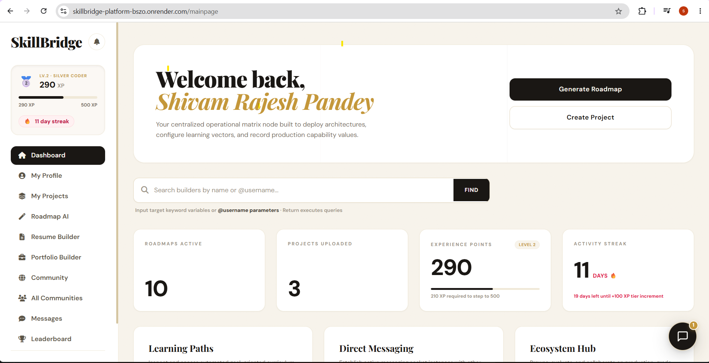

**AI roadmap generator**  : Enter a goal and get a staged roadmap with resources and project ideas. Tick Profile, Resume details or Projects to personalise it.

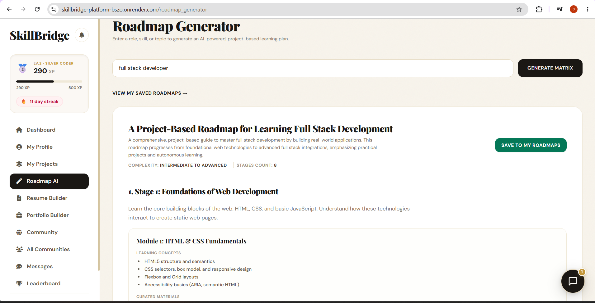

**Personalised dashboard**  : XP, streak and activity in one place.

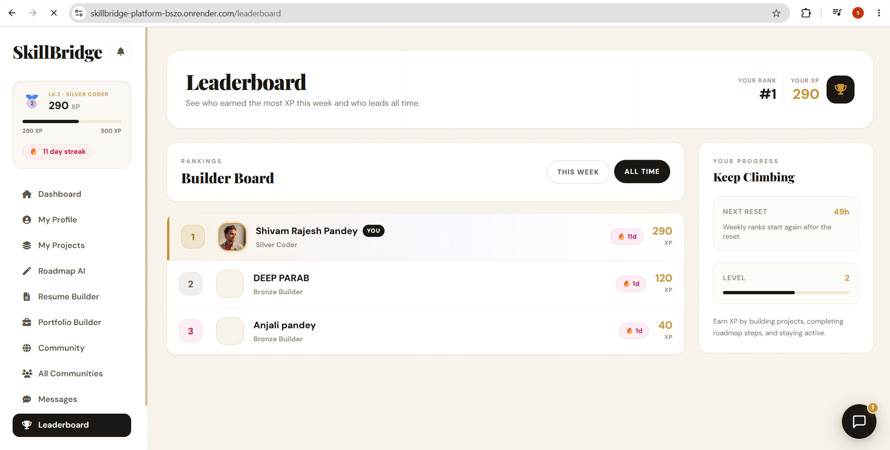

**Communities**  : Join communities, chat, and see recommendations based on your skills.

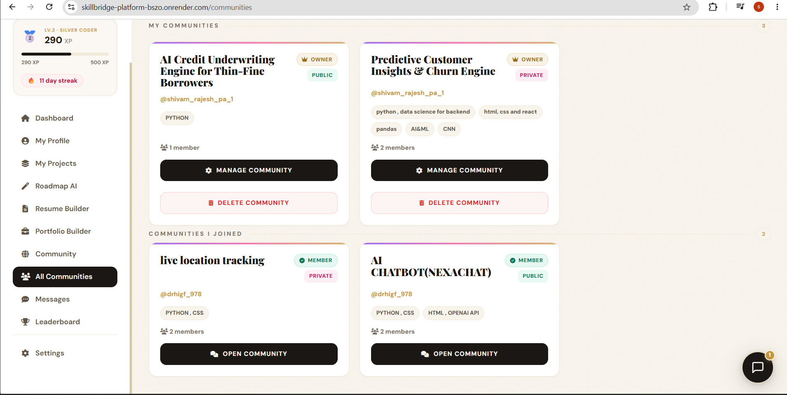
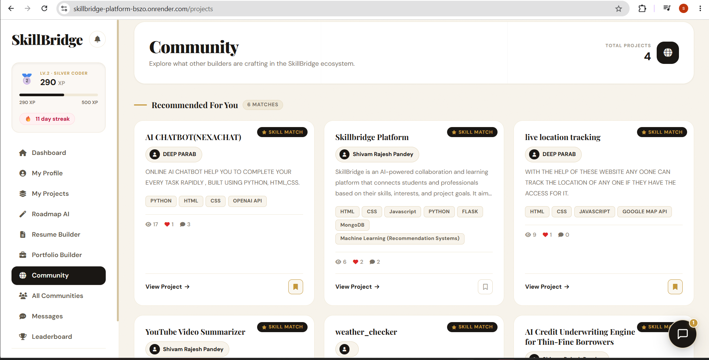

**Resume builder**  : 19 templates built from your profile, completed projects and certificates.

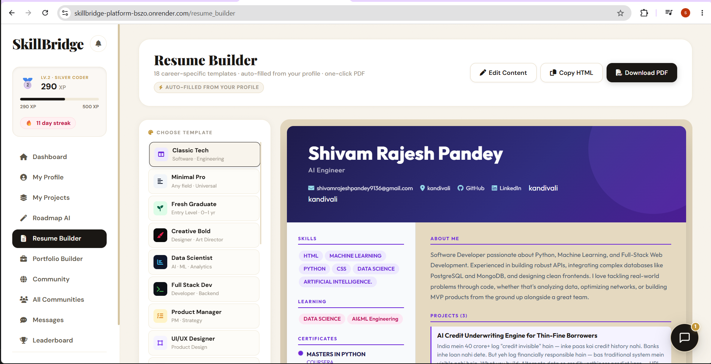

**Portfolio builder**  : Generate a developer portfolio from your profile and projects.

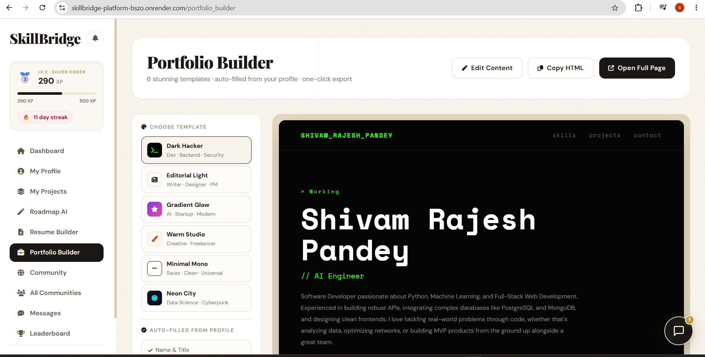

**Settings and progress**  : XP, rank progression and account preferences.

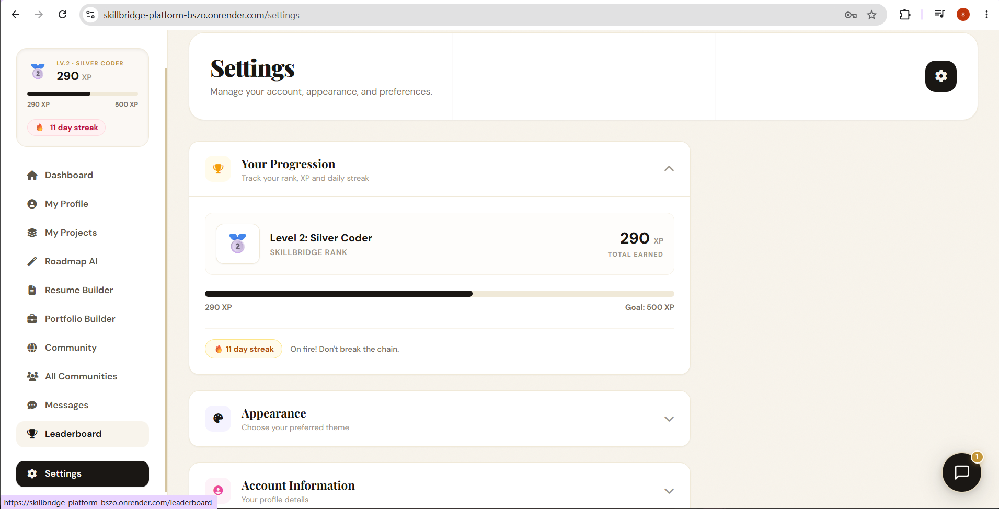

**Admin panel**  : Approvals, users, projects, roadmaps and communities in one place.

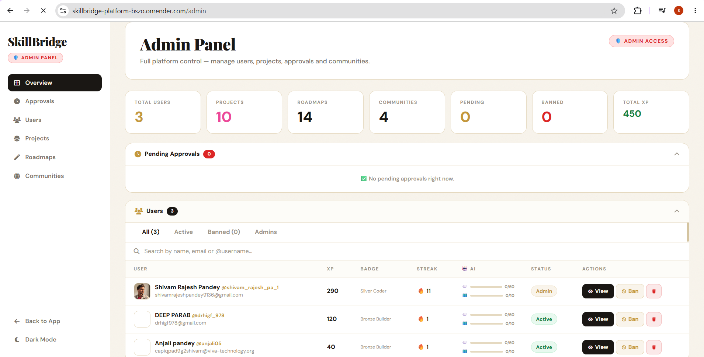

## Features

- **AI roadmap generator.** Stage-by-stage plan with learning modules, free and paid resources, a project idea for every stage and a final capstone project. Optional personalisation from your profile, resume details and projects.
- **AI chatbot and mock interviews.** The interview adapts its difficulty to your scores and keeps a history.
- **Resume builder.** 19 templates, live editing, and a print-ready PDF view.
- **Portfolio builder.** Template-based portfolio generation.
- **Projects.** Create projects, upload versions as `.zip`, like, bookmark, and comment with replies. Import repositories from GitHub.
- **Communities and messages.** Join requests, member roles, message reactions and direct messages.
- **Gamification.** XP, levels, streaks and a weekly leaderboard.
- **Notifications and reminders.** In-app notifications and email reminders for inactive roadmaps, with unsubscribe links.
- **Accounts.** Email verification, password reset, timezone, and account deletion with a 30-day trash.
- **Admin system.** Approve or reject project versions, ban or restore users, adjust XP, and moderate projects, roadmaps and communities.

## Architecture

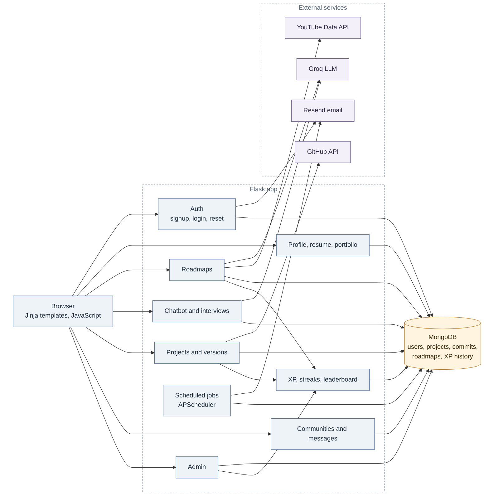

## How it works

### Roadmap generation, with optional personalisation

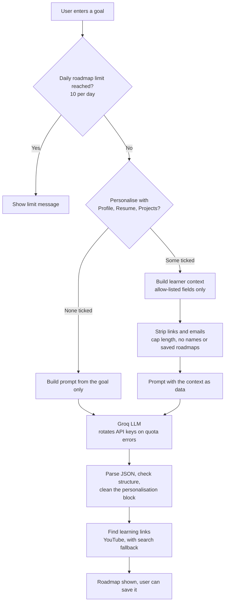

### From a project upload to XP

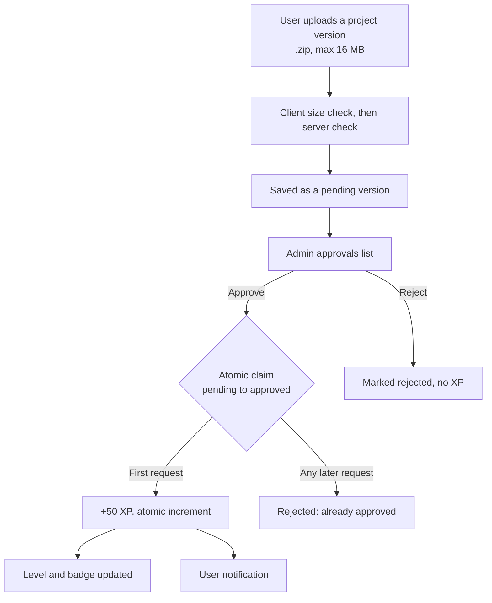

## XP and levels

| Action | XP |
|---|---:|
| Project version approved by an admin | +50 |
| Mock interview completed | +50 |
| 7-day streak / 30-day streak | +35 / +100 |
| Profile 100% complete (once) | +30 |
| Connected GitHub profile | +25 |
| Added a certificate | +15 |
| Created a project, imported a project, joined a community | +10 each |
| Completed a roadmap stage | +5 |

Deleting a certificate (−15), a project (−10 plus −50 for each approved version) takes the XP back. XP never goes below zero.

| Level | Badge | XP |
|---:|---|---|
| 1 | Bronze Builder | 0 to 199 |
| 2 | Silver Coder | 200 to 499 |
| 3 | Gold Developer | 500 to 999 |
| 4 | Platinum Architect | 1000 to 1999 |
| 5 | Diamond Founder | 2000+ |

The weekly leaderboard resets every Monday at 12:00 AM UTC.

## Key engineering decisions

| Decision | Why | Evidence |
|---|---|---|
| Atomic XP updates (`$inc`) and an atomic pending-to-approved claim | Two events at the same moment could overwrite each other or pay twice | Checked by hand. The automated tests do **not** cover XP or approvals (see Testing and verification) |
| XP is taken back when a certificate or project is deleted, floored at 0 | Stops add, delete, repeat XP farming | Delete handlers call `deduct_xp`. Checked by hand, not by the automated tests |
| AI personalisation reads only an allow-list of profile fields | Name, email, location, links, company names and saved roadmaps never reach the AI | `services/roadmap_context.py` reads 10 named fields; links and emails are stripped from free text |
| Personal data goes to the AI as quoted data, not instructions | Text a user typed in a project description cannot steer the prompt | Context is wrapped in tags with an instruction to ignore commands inside it |
| Rate limits keyed per account for AI features, IP plus email for login | A VPN or shared IP should not bypass or unfairly block users | `get_user_key` and `get_login_key` in `services/utils.py` |
| Per-feature daily AI limits | Keeps Groq usage predictable | 50 chat messages, 10 roadmaps, 5 interviews per day |
| Same validation rules on the client and the server, with exact ranges in the error message | The browser can be bypassed, and users need to know the allowed range | Experience 0 to 50 years, CGPA 0 to 10, percentage 0 to 100, years 1980 to current year |
| Accounts go to a 30-day trash before they are purged | Gives users and admins a way to undo a deletion | Daily purge job at midnight IST |
| One 5,313-line `app.py` split into 17 route modules and a services layer | Easier to read, test and change | Endpoint check and baseline comparison scripts in `tools/`, and 67 automated checks in `tests/` |

## Testing and verification

```bash
python -m unittest discover -s tests -t . -v     # 34 Python tests
node tests/js/profile_validators.test.js         # 33 browser-side checks
```

The tests need no database, API keys or `.env`, and finish in well under a second. They pass on Python 3.12 on Windows, and a GitHub Actions workflow runs them on every push.

| Area | What is checked |
|---|---|
| Profile rules | Experience 0 to 50, CGPA 0 to 10, percentage 0 to 100, year ranges, work experience limits, social links, and the profile page with junk stored for the user |
| AI personalisation | No name, email, links or saved roadmaps in the prompt, each switch shares only its own section, the model's answer is trimmed and type-checked |
| Uploads | A file over 16 MB shows a message, redirects stay on the site |
| Browser validators | The same ranges and error messages, read directly from `templates/profile.html` |

<details>
<summary>How the tests work</summary>

`tests/support.py` replaces `extensions.py` (which connects to MongoDB as soon as it is imported) with a stub, and loads individual route functions straight from the source files, so the real code is tested, not a copy. Where a test needs a database answer, it uses a simple mock that returns a prepared user.

</details>

**Not covered by the automated tests:** XP awards and deductions, admin approval of project versions, certificate add and delete, real AI calls and pages in a real browser. These need a real database or a browser, so they are checked by hand before a release (approve a version once and the user gets +50 XP, approving it again is refused; add a certificate for +15 XP and delete it for -15 XP). Roadmap quality is **not evaluated**; the model's output is only checked for valid structure.

Refactor checks from earlier work are still in `tools/` (`check_endpoints.py` for registered endpoints, `dump_baseline.py` and `compare_baseline.py` to compare routes before and after a change), plus `edit_test_checklist.md` for the resume builder and `audit_report.md` for the refactor audit.

## Security

**Implemented:**

- Passwords are hashed with bcrypt.
- Email verification and password reset use signed, time-limited tokens.
- Rate limits on login, signup, password reset, uploads and AI calls. Default limits are 200 per day and 50 per hour.
- Free-text profile fields are sanitised with bleach.
- Admin routes require an admin account. Users can only edit or delete their own projects.
- Uploads: project versions are `.zip` only and capped at 16 MB, checked in the browser and on the server. Profile photos must be PNG, JPG, GIF or WEBP, up to 2 MB, and the file header is checked.
- Social links must be `http(s)` links on the platform's own domain.
- XP changes are atomic, and approvals cannot be paid twice.

**Not implemented yet:**

- No CSRF tokens. Flask-WTF is installed but not enabled.
- No Content-Security-Policy or other security headers, and session cookie flags are not set explicitly.
- The automated tests cover profile validation, AI privacy, upload limits and the browser validators. They do not cover XP, admin approvals, certificate add and delete, or real AI calls.
- Uploaded project zips are stored on the server's disk (see Limits).

**Secrets.** Settings come from environment variables or a git-ignored `.env` file. If `FLASK_SECRET_KEY` is missing, a random key is generated at each start, which logs everyone out and breaks sessions across several workers. Always set it.

**What leaves your server.**

| Feature | Provider | What is sent |
|---|---|---|
| Roadmap generation | Groq | The goal. If personalisation is on, the allowed profile, resume and project summaries |
| Chatbot and mock interviews | Groq | Your messages, interview answers and recent history |
| Learning resources | YouTube Data API | Search queries built from the roadmap topics |
| GitHub import and sync | GitHub | The GitHub username and API requests |
| Verification, reset and reminder emails | Resend | Email address and the link |
| All app data | MongoDB | Stored in the database you configure |

## Quick start

Requirements: Python 3.12, a MongoDB database (local or Atlas), and API keys for Groq, YouTube and Resend.

```bash
git clone https://github.com/Shivam7977/SkillBridge-Platform.git
cd SkillBridge-Platform
python -m venv venv && source venv/bin/activate    # Windows: .\venv\Scripts\Activate.ps1
python -m pip install -r requirements.txt
cp .env.example .env     # then fill in the values, see Configuration
python app.py
```

Open [http://127.0.0.1:5000](http://127.0.0.1:5000). A health check is at `/health`.

> Run `python app.py` inside the activated virtual environment. A `No module named 'flask_limiter'` error means the packages are not installed for the Python you are using.

<details>
<summary>Configuration</summary>

| Variable | Default | Purpose |
|---|---|---|
| `MONGO_URI` | `mongodb://127.0.0.1:27017/skillbridge_db` | MongoDB connection string. |
| `FLASK_SECRET_KEY` | random per start | Signs sessions and email tokens. Set it. |
| `GROQ_API_KEY_1`, `GROQ_API_KEY_2` | none | Groq keys. The app rotates to the second key on quota errors. |
| `YOUTUBE_API_KEY` | none | Finds learning playlists for roadmap stages. |
| `GITHUB_TOKEN` | none | Used for GitHub API requests. |
| `RESEND_API_KEY` | none | Sends verification, reset and reminder emails. |
| `APP_BASE_URL`, `PUBLIC_BASE_URL` | none | Base URL used in links inside emails. |

</details>

<details>
<summary>Deployment</summary>

The `Procfile` runs `gunicorn -w 4 -b 0.0.0.0:5000 --timeout 120 wsgi:app`, so the app runs on hosts such as Render. The longer timeout leaves room for AI, email and YouTube calls. Set every variable above in the host's environment settings, and allow the host's IP in your MongoDB Atlas network access.

</details>

<details>
<summary>Main routes</summary>

| Area | Routes |
|---|---|
| Accounts | `/signup`, `/verify`, `/login`, `/forgot_password`, `/reset_password/<token>`, `/settings`, `/delete_account` |
| Profile | `/profile`, `/profile/save/<card>`, `/certificates/add`, `/user/<id>` |
| Roadmaps | `/roadmap_generator`, `/save_roadmap`, `/my_roadmaps`, `/roadmap/<id>` |
| AI | `/api/chatbot`, `/interview`, `/interview/ask`, `/interview/complete` |
| Projects | `/projects`, `/create_project`, `/project/<id>`, `/project/<id>/upload`, `/project/<id>/like` |
| Communities | `/communities`, `/community/<id>`, `/api/community/<id>/messages` |
| Gamification | `/leaderboard`, `/api/xp_history`, `/api/xp_status`, `/api/ai_usage` |
| Resume and portfolio | `/resume_builder`, `/resume_pdf`, `/portfolio_builder` |
| GitHub | `/api/github/fetch`, `/api/github/sync`, `/api/github/disconnect` |
| Admin | `/admin`, `/admin/approve_commit/<id>`, `/admin/reject_commit/<id>`, `/admin/adjust_xp/<user_id>` |

</details>

<details>
<summary>Troubleshooting</summary>

- **`No module named 'flask_limiter'`:** activate the virtual environment and run `python -m pip install -r requirements.txt`.
- **`MongoDB connection` fails:** check `MONGO_URI`, and in Atlas add your IP under Network Access.
- **Roadmap or chatbot does not answer:** check the Groq keys, and check the daily limits (50 chats, 10 roadmaps, 5 interviews).
- **Upload shows "File is too large":** the limit is 16 MB. Remove `node_modules`, `venv`, `.git` or build folders from the zip.
- **Everyone is logged out after a restart:** `FLASK_SECRET_KEY` is not set.

</details>

<details>
<summary>Limits and known gaps</summary>

- Project zips are stored on the server's disk. On Render the disk is not persistent, so uploaded files can disappear after a restart or redeploy while their database records stay.
- Scheduled jobs (weekly XP reset, inactivity reminders, trash purge) start inside each worker process, and the default `Procfile` runs 4 workers. Jobs can therefore run more than once.
- Project recommendations rank projects by the number of skills they share with you. This is a simple overlap count, not a learned model.
- `/api/recalculate_xp` is a repair tool. It can only lower XP and ignores some XP sources.
- AI limits per day: 50 chat messages, 10 roadmaps and 5 interviews. Uploads are capped at 16 MB.

</details>

## Project Structure

```
SkillBridge-Platform/
├── app.py                         # Entry point
├── wsgi.py                        # Gunicorn entry
├── extensions.py                  # Flask app, MongoDB, limiter, bcrypt, scheduler
├── models.py                      # User model for Flask-Login
├── ai_roadmap_generator.py        # Groq calls, JSON parsing, YouTube lookups
├── recommendation_engine.py       # Skill-overlap project recommendations
├── routes/
│   ├── auth.py                    # Signup, verify, login, password reset
│   ├── account.py                 # Settings, password change, delete account
│   ├── profile.py                 # Profile cards, certificates, validation
│   ├── roadmap.py                 # Roadmap generator and saved roadmaps
│   ├── chatbot.py                 # AI chatbot
│   ├── interview.py               # Mock interviews, adaptive difficulty
│   ├── projects.py                # Projects and version uploads
│   ├── project_social.py          # Likes, bookmarks, comments
│   ├── communities.py             # Communities and chat
│   ├── messaging.py               # Direct messages
│   ├── resume_portfolio.py        # Resume and portfolio builders
│   ├── github_sync.py             # GitHub import and sync
│   ├── gamification.py            # Leaderboard, XP history, AI usage
│   ├── admin_users.py             # Admin panel, approvals, XP adjust
│   ├── admin_content.py           # Admin moderation of projects, roadmaps, communities
│   ├── misc.py                    # Search, notifications, onboarding, health
│   └── errors_hooks.py            # Error pages and request hooks
├── services/
│   ├── xp.py                      # XP, levels, streaks
│   ├── ai_limits.py               # Daily AI limits
│   ├── roadmap_context.py         # Privacy-filtered context for personalised roadmaps
│   ├── notifications.py           # In-app notifications
│   ├── email_service.py           # Email sending
│   ├── account_service.py         # Account trash and purge
│   ├── jobs.py                    # Scheduled jobs
│   ├── time_utils.py              # Timezones
│   └── utils.py                   # Validation helpers, rate-limit keys
├── templates/                     # Jinja pages, 19 resume templates
├── static/
│   ├── upload_guard.js            # Client-side upload size and type check
│   ├── dark.css, mobile.css
│   └── portfolio_img/, portfolio_assets/, profile_pics/, project_uploads/
├── tests/                         # 34 Python tests + 33 browser checks, no database needed
│   ├── test_*.py, support.py
│   └── js/profile_validators.test.js
├── tools/                         # Endpoint check, baseline comparison
├── .github/workflows/tests.yml    # Runs the tests on every push
├── README_img/                    # Screenshots
├── Procfile, gunicorn.conf.py
├── requirements.txt
└── README.md
```

## License

MIT. See [LICENSE](LICENSE).


## Developer

Built by **Shivam Pandey**.

[](https://www.linkedin.com/in/shivam-rajesh-pandey/) [](https://shivam-pandey-ai.netlify.app/) [](https://github.com/Shivam7977)